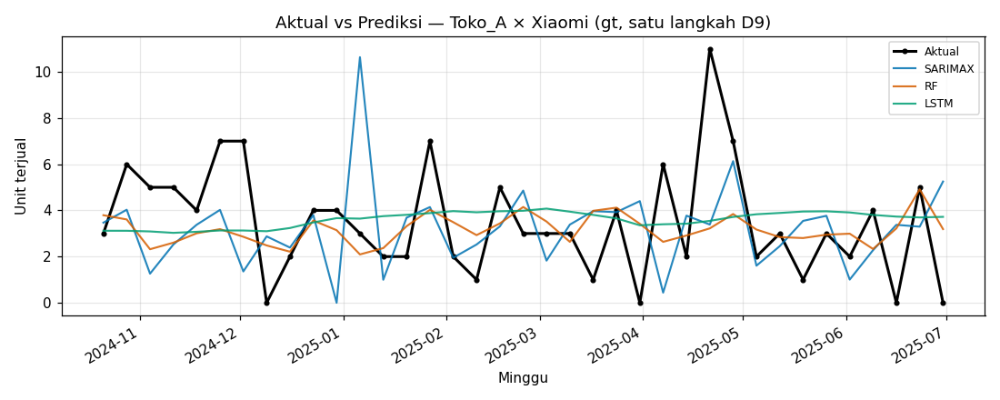
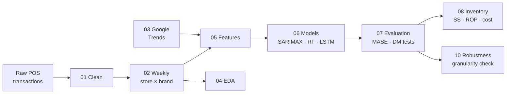

# Smartphone Demand Forecasting & Inventory DSS

End-to-end decision-support pipeline that forecasts weekly smartphone demand for a
multi-store retailer and turns those forecasts into safety-stock and reorder
recommendations. Built as nine self-contained Jupyter notebooks, one per stage, from
raw POS transactions to inventory policy, each ending in a verification cell that
fails loudly if a reported number stops reproducing.

> Undergraduate thesis project (Tugas Akhir). Notebook narrative and figure labels are
> in Bahasa Indonesia; code and comments are in English.



---

## Results at a glance

20 store × brand weekly series (4 stores × 5 brands), 184 weeks, 80:20 temporal split
(147 train / 37 test weeks), one-step-ahead walk-forward evaluation.

| Model | Variant | MAE | MASE |
|-------|---------|----:|-----:|
| **Random Forest** | **+ Google Trends** | **1.400** | **0.762** |
| Random Forest | baseline | 1.407 | 0.763 |
| LSTM | + Google Trends | 1.540 | 0.843 |
| SARIMAX | + Google Trends | 1.595 | 0.864 |
| Seasonal naïve | — | 1.786 | 0.982 |
| Naïve | — | 1.862 | 1.000 |

- **~25% lower MAE than the naïve baseline** (MASE 0.762 < 1). The win over SARIMAX,
  LSTM, naïve and seasonal naïve is statistically significant (Diebold–Mariano,
  all p < 0.001).
- **Google Trends was tested, not assumed.** It gave a significant gain for RF
  (DM = 2.49, p = 0.013) but not for SARIMAX (p = 0.11) or LSTM (p = 0.10).
- **Error is close to the noise floor.** sMAPE is ≈ 84%, against a theoretical
  floor of ≈ 67% for intermittent low-volume demand. Most of the remaining error
  can't be reduced.
- **Inventory impact.** An order-up-to policy driven by RF forecasts reaches a
  99.3% fill rate with the lowest safety stock and holding cost of the three models.
- **Ten accuracy "improvements" were tried and rejected** (Poisson RF/HGB,
  Croston/TSB, ensembles). None beat the incumbent significantly, so none were
  adopted.

## Pipeline



| # | Notebook | What it does |
|---|----------|--------------|
| 01 | `01_cleaning` | Cleans 6,320 POS rows: removes voids and duplicates, maps products to brands |
| 02 | `02_aggregation` | Aggregates to weekly store × brand series; guards zero-week share ≤ 30% |
| 03 | `03_google_trends` | Per-brand Google Trends index, served from an offline cache |
| 04 | `04_eda` | ADF stationarity, decomposition, ACF/PACF, seasonality |
| 05 | `05_features` | Lags, rolling stats, Fourier terms; leakage-safe baseline and GT variants |
| 06 | `06_modeling` | SARIMAX, Random Forest, LSTM, naïve baselines, 10 challenger models |
| 07 | `07_evaluation` | MAE/MASE/sMAPE, Diebold–Mariano tests, GT ablation, model selection |
| 08 | `08_inventory` | Safety stock, reorder point, order-up-to level, cost simulation, sensitivity |
| 10 | `10_robustness` | Checks whether per-SKU forecasting beats the store × brand choice |

Stage 09 (a Streamlit dashboard) lives in the original package repository and is
intentionally not part of this notebook rebuild.

## Methodology highlights

- **No look-ahead leakage.** Rolling features are shifted so each window ends at
  t−1. Scalers are fit on the training partition only. The exogenous signal is
  excluded from the baseline variant.
- **Same evaluation protocol for every model.** All models are scored one step
  ahead with walk-forward evaluation. SARIMAX uses state updates without refitting;
  RF and LSTM forecast one step natively.
- **Success criterion that holds up on sparse data.** A model counts as successful
  when MASE < 1 *and* it beats naïve significantly under a Diebold–Mariano test.
  MAPE is not used, because it breaks on zero-heavy weekly demand.
- **Data-driven seasonality.** Seasonal orders are chosen per series by AIC rather
  than forced, with Fourier terms (m = 52) available in both feature variants.
- **Hyperparameters tuned with expanding-window `TimeSeriesSplit`.**
- **Negative and mixed results are reported as they are.** No challenger model was
  adopted. The granularity check is mixed: for RF, per-SKU forecasting is no better
  (p = 0.35), so the simpler store × brand level stays; for LSTM, per-SKU is
  significantly better. That is noted as future work, not hidden.
- **Self-verifying notebooks.** Each notebook ends with assertions against locked
  reference values and prints ✅ or raises with expected vs. actual. `pytest` runs
  every notebook from a clean kernel with `nbmake`.

## Quick start

```powershell
git clone https://github.com/filan214/smartphone-dss-notebooks.git
cd smartphone-dss-notebooks
python -m venv .venv
.\.venv\Scripts\Activate.ps1        # macOS/Linux: source .venv/bin/activate
pip install -r requirements.txt

jupyter lab                          # open notebooks/ and run 01 → 10 in order
pytest                               # executes all 9 notebooks; expect "9 passed"
```

Everything runs **offline**. Google Trends comes from a bundled cache, and the
model predictions behind stages 7–10 are bundled too, so nothing has to be retrained.

## Reproducibility

Two switches control the expensive and destructive paths. Both are off by default:

| Switch | Default | Effect when `True` |
|--------|---------|--------------------|
| `RETRAIN` | `False` | Refits all models (120 fits in stage 06; SKU-level fits in stage 10) |
| `SAVE_ARTIFACTS` | `False` | Lets a run overwrite the bundled reference artifacts |

With the defaults, stages 4–5 recompute from the deterministic weekly and Google
Trends data, stages 7–8 recompute every metric, test and inventory figure from the
bundled stage-6 predictions, and stage 10 loads its bundled evidence. The headline
numbers reproduce within the tolerances asserted in each notebook. A full retrain is supported but is not bit-identical
across machines, because TensorFlow LSTM training is non-deterministic.

> Dengan `RETRAIN=False`, notebook membuktikan Tahap 4, 5, 7, 8, 10 menghitung ulang dari prediksi Tahap 6 tersimpan dan mereproduksi angka utama — BUKAN bahwa proses fit mahal (khususnya LSTM/TensorFlow) identik bit-per-bit antar mesin.

## Tech stack

Python 3.13 · pandas · NumPy · statsmodels (SARIMAX, ADF) · pmdarima ·
scikit-learn (Random Forest) · TensorFlow/Keras (LSTM) · SciPy · matplotlib ·
pytrends · Jupyter + Jupytext · pytest + nbmake. Versions are pinned in
`requirements.txt`.

## Repository layout

```
config.yaml          all parameters (seed, split, lags, grids, service level, …)
notebooks/           NN_*.ipynb (executed) + NN_*.py (Jupytext source, paired)
data/raw/            bundled POS transactions
data/interim/        cleaned transactions, weekly series, Google Trends cache
data/processed/      per-series feature matrices (20 files)
reports/figures/     EDA and actual-vs-forecast plots
reports/results/     predictions, metrics, DM tests, inventory and robustness tables
```

Every parameter is read from `config.yaml`, and every path is resolved relative to the
repository root, so nothing is hard-coded to a single machine.

## Author

**Valentinus Filan** · [github.com/filan214](https://github.com/filan214)
